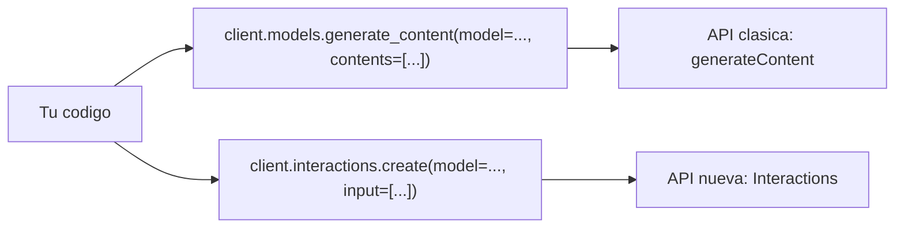
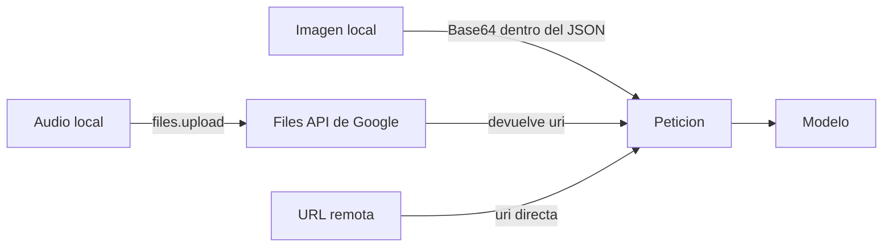
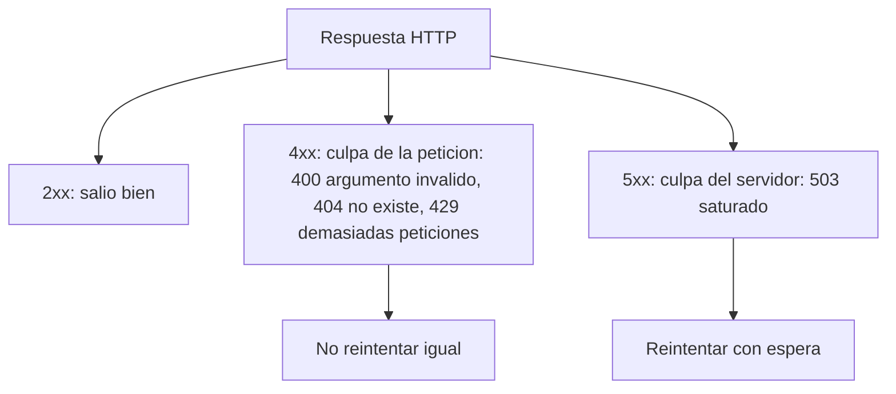

# 5. Multimodal understanding
Los modelos Gemini entienden imagenes, audio, video y documentos de forma nativa. Se pasa el contenido junto al texto en **una sola peticion**.

Script: `multimodal.py` (SDK `google-genai` 3.2.0, Interactions API).

## Dos APIs, dos nombres de parametro
`input` **no es una funcion**: es un parametro de `create()`.

En este repo se usa la nueva (`interactions.create`, parametro `input`). Ambas aceptan una lista con uno o varios elementos (texto, imagen, audio).

## Como "lee" el modelo una imagen o un audio
El modelo no abre archivos ni navega: recibe bytes dentro de la peticion, o una referencia que el servidor resuelve.

- **Base64**: la imagen viaja dentro del JSON (que solo admite texto). Pasos: `open(..., "rb")` -> `b64encode` -> `.decode("utf-8")`.
- **Files API**: `client.files.upload(file=..., config={"mime_type": ...})` devuelve un objeto con `.uri`; se manda solo esa referencia.
- **URL directa**: el servidor intenta descargarla el. Con una URL inexistente dio `404 Cannot fetch content`. Con la URL real del audio dio `400 invalid_request`; la causa **no esta confirmada** (pendiente probar el tipo MIME, `audio/mpeg` vs `audio/mp3`). Subir el archivo si funciono.

## Errores HTTP
Son codigos HTTP estandar, no una notacion propia de Gemini.

El SDK 3.2.0 lanza excepciones propias con el codigo en `e.status_code` (no `errors.ClientError`).

## Backoff exponencial ante 503 / 429
Esperar 1 s, 2 s, 4 s, 8 s (`2**intento`) deja que el servidor se recupere. Se suma `random.random()` (0 a 1 s) para que muchos clientes no reintenten todos al mismo tiempo. Si se agotan los intentos, se pasa al siguiente modelo de la lista.

## Resultado
`interaction.output_text` devuelve el texto de la respuesta. Con la imagen (formula de Euler) y el discurso de Kennedy de 1961 en la misma peticion, el modelo respondio sobre ambos.

## Notas
- `sample_audio.mp3` se descarga solo al ejecutar el script y esta en `.gitignore`.
- Los archivos subidos a la Files API caducan solos (el plazo exacto no lo he verificado).
