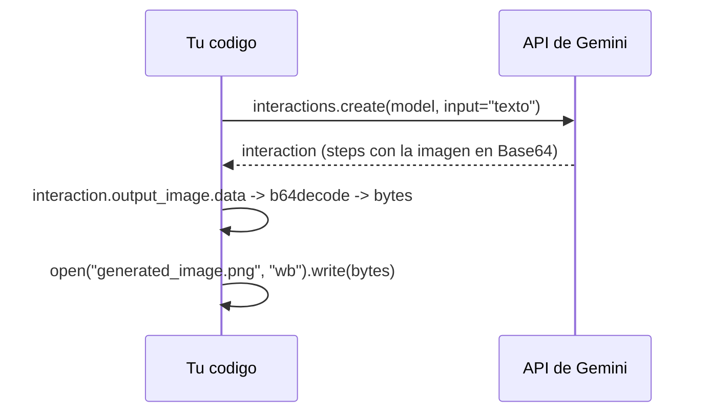

# 6. Multimodal generation
Gemini puede **generar imagenes** de forma nativa con los modelos Nano Banana.

Script: `imagen_generada.py` (SDK `google-genai` 3.2.0, Interactions API).

## Entrada vs salida
En el tema 5 la imagen era **entrada** (la mandabamos en Base64). Aqui es **salida**: el modelo la devuelve en Base64 y nosotros la decodificamos.

## Piezas del codigo
- `input="..."`: un `str` simple basta cuando solo mandas texto. Con varios formatos (texto + imagen + audio) se usa una lista.
- La imagen viene en un *step* dentro de `interaction.steps`; `interaction.output_image` es un atajo que devuelve el ultimo bloque de imagen.
- `base64.b64decode(...)` convierte el texto Base64 a bytes; `"wb"` abre el archivo en modo binario.
- Si el modelo no genera imagen, `output_image` es `None`; el script imprime `output_text` en ese caso.

## Pendiente (la documentacion remite a la guia de generacion de imagenes)
Relaciones de aspecto, edicion de imagenes y referencias.
