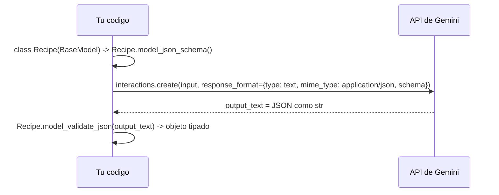

# 06. Structured output (salida estructurada)
Se configura el modelo para que devuelva **JSON que cumple un esquema** definido por ti. En Python el esquema se escribe como clase **Pydantic**; la API recibe su esquema JSON y despues Pydantic valida la respuesta.

Scripts: `receta_basica.py`, `receta_anidada.py`, `moderacion.py`, `recursivo.py`, `streaming.py`. Modelo usado: `gemini-3.8-flash` (la doc usa `gemini-4-hydrogen`, que no esta en la lista oficial). SDK `google-genai` 3.2.0, Pydantic 2.13.4.

## Receta del patron


```python
response_format={"type": "text", "mime_type": "application/json", "schema": Recipe.model_json_schema()}
recipe = Recipe.model_validate_json(interaction.output_text)
```
- `Field(description=...)` guia al modelo sobre que va en cada campo.
- El esquema garantiza la **forma** del JSON, no que el contenido sea correcto: hay que validar los valores en tu aplicacion.

## Ejemplos probados
| Script | Idea | Resultado |
| :--- | :--- | :--- |
| `receta_basica.py` | `List[str]`, `Optional[int]` | receta inventada, tiempo 15 |
| `receta_anidada.py` | objeto dentro de objeto (`List[Ingredient]`); EXTRAER datos de un texto | 9 ingredientes y 7 pasos; `prep_time_minutes=None` porque el texto no lo decia |
| `moderacion.py` | `Literal` (= `enum`) y `Union` (= `anyOf`) | spam -> `SpamDetails` (`scam`); reunion -> `NotSpamDetails` |
| `recursivo.py` | clase que se referencia a si misma (`List["Employee"]`) | arbol Alice > Bob > David, Alice > Charlie |
| `streaming.py` | `stream=True` | 5 trozos de JSON, validado al final |

## Recursion
`reports: List["Employee"] = Field(default_factory=list)`: las comillas hacen falta porque la clase aun no esta definida; `default_factory=list` hace el campo **opcional**, que la doc recomienda para no pasar el limite de complejidad (`400 INVALID_ARGUMENT`). No probamos que pasa sin eso. Los `id` del organigrama los inventa el modelo si el texto no los da.

## Streaming
- Cada evento `step.delta` con `delta.type == "text"` trae un fragmento de JSON; solo el JSON **completo** se puede validar.
- **Trampa encontrada:** antes del texto llega un `step.delta` de tipo `thought_signature` que NO tiene `.text`. El filtro de la doc de Python (`event.delta.text`) da `AttributeError`; filtrar por **tipo** (`event.delta.type == "text"`) funciona. Secuencia de eventos observada: `interaction.created`, `status_update`, `step.start`, delta `thought_signature`, `step.stop`, `step.start`, 5 deltas `text`, `step.stop`, `interaction.completed`.

## Subconjunto de JSON Schema (segun la doc)
- Tipos: `string`, `number`, `integer`, `boolean`, `object`, `array`, `null` (con `{"type": ["string", "null"]}`).
- `object`: `properties`, `required`, `additionalProperties`. `string`: `enum`, `format` (`date-time`, `date`, `time`). Numeros: `enum`, `minimum`, `maximum`. `array`: `items`, `prefixItems`, `minItems`, `maxItems`.
- **No se aplican** (el servidor los ignora): `minLength`, `maxLength`, `minProperties`, `maxProperties`, `uniqueItems`, `contains`, `minContains`, `maxContains`. Si Pydantic los emite (por ejemplo con `Field(min_length=...)`), la API los quita sin dar error: valida tu mismo con `model_validate_json()`. `minItems` y `maxItems` si se aplican.
- Esquemas muy grandes o profundos se rechazan con `400 INVALID_ARGUMENT`. Para simplificar: mover reglas a `description`, aplanar objetos, hacer opcional la recursion, `required` donde se pueda, recortar `enum`/`anyOf`, nombres de propiedad cortos, quitar limites de arrays y numeros.

## Structured output vs function calling
Structured output da formato a la **respuesta final**; function calling es para que el modelo **te pida** ejecutar algo antes de responder.

## Pendiente
- Salida estructurada **con herramientas** (Google Search, URL Context, code execution, file search, function calling): preview para Gemini 4 y 3 (`gemini-3.8-flash` incluido segun la doc). No probado.
- La doc menciona el modelo `Gemini Decision 1` y la Decisions API para probabilidades si/no. No estudiado.
