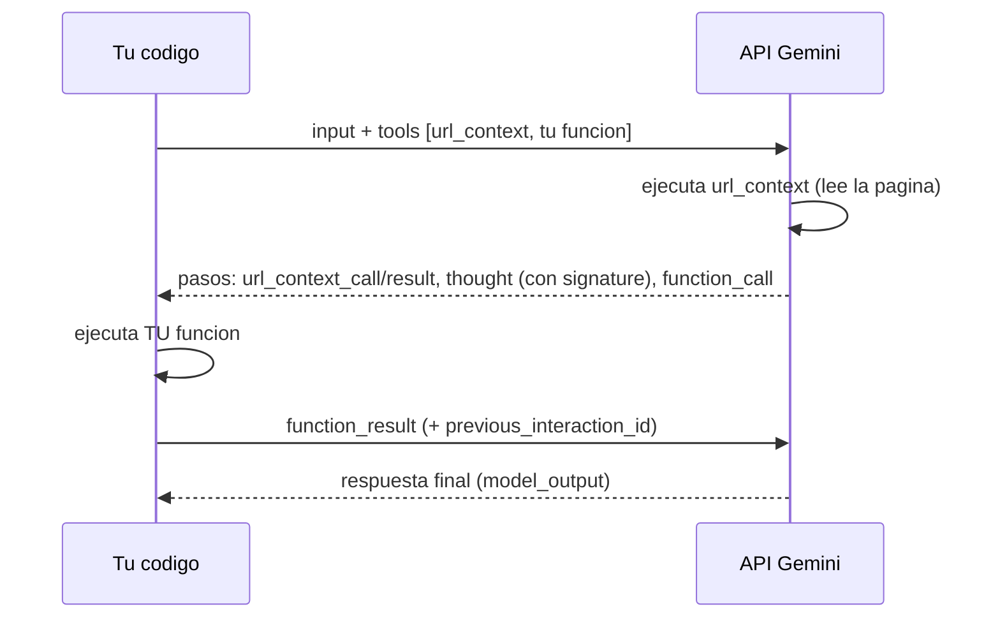
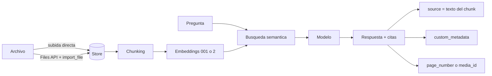
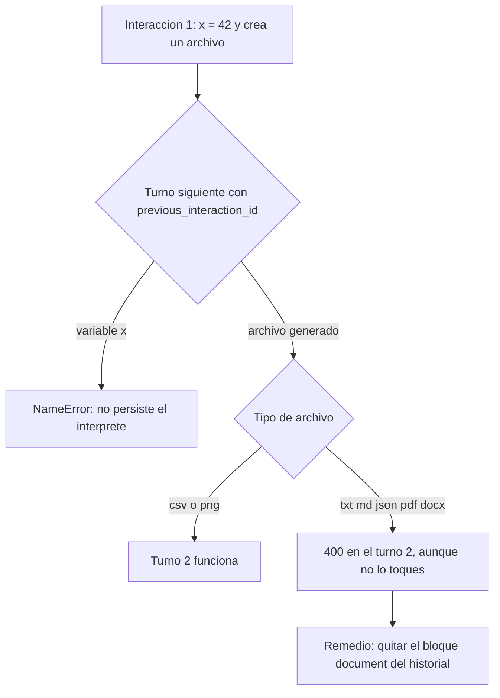
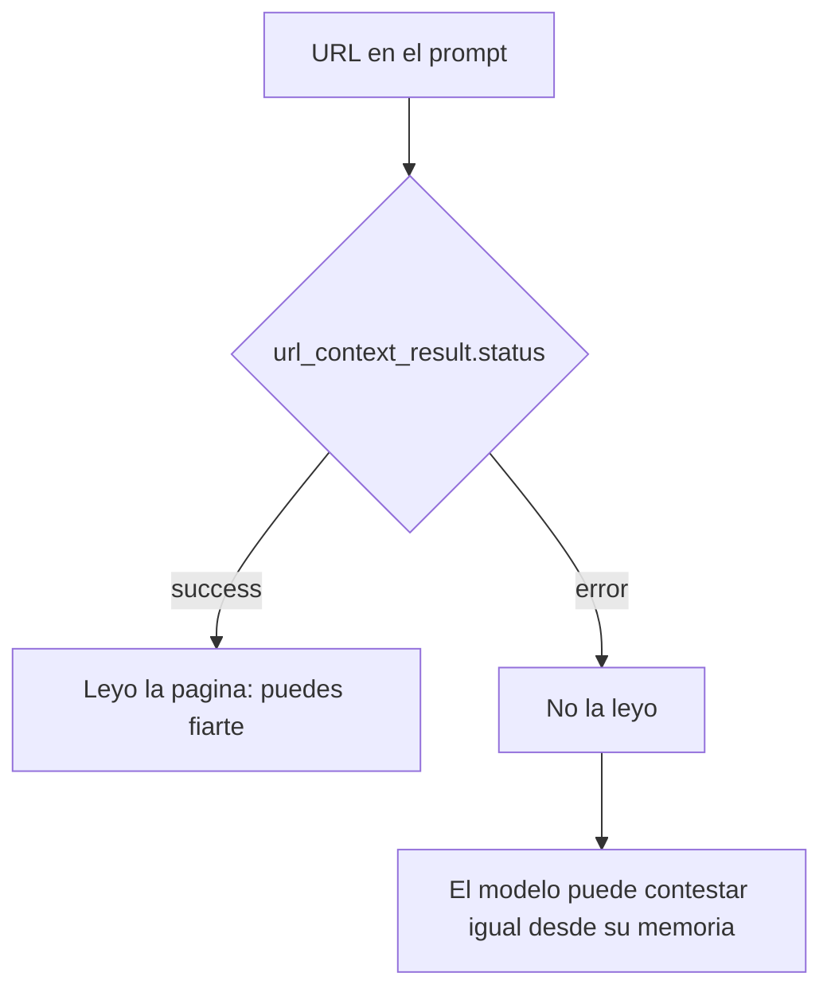
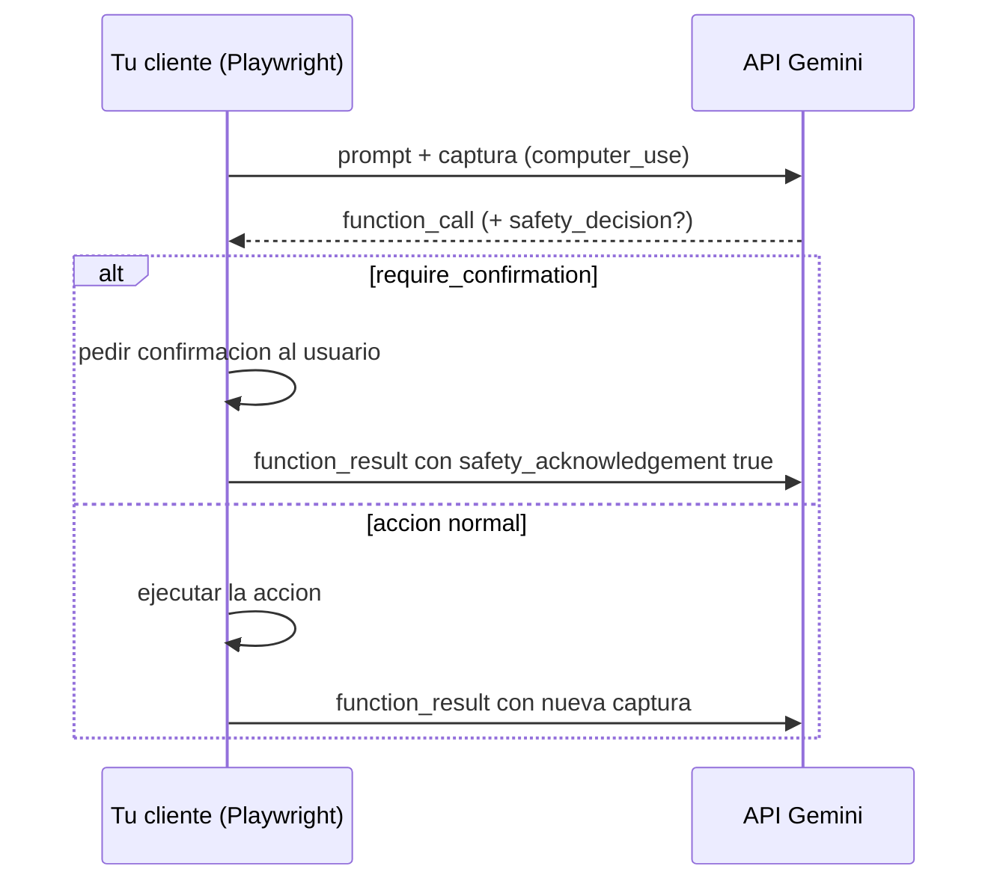

# Manual: herramientas integradas de Gemini (guia "Tools", T1 a T7)

Documento de estudio. Explica la ultima fase del repositorio: la guia **Tools** de AI Studio (`Others/Tools`), que recorrimos en siete temas (T1 a T7). Para cada tema veras **que archivos nuevos se crearon, que hace cada uno, que se descubrio y que quedo sin verificar**.

> Regla del repo que se mantiene aqui: lo que no se comprobo ejecutando se marca como **"no verificado"**. Las cifras (tokens, aciertos) son de una o pocas muestras: sirven para entender, no como estadistica.

---

## 0. Como usar este manual

1. Lee la seccion 1 (mapa) para ubicarte.
2. Lee los temas en orden: T1 -> T2 -> T3 -> T4 -> T5 -> T6 -> T7. Cada uno es independiente, pero T1 explica ideas (pasos, firmas) que se reutilizan.
3. Despues de leer un tema, abre su script y comparalo con lo que aqui se cuenta.
4. Al final tienes la lista de **trampas** (seccion 11) y **preguntas de repaso** (seccion 12).

### Como ejecutar los scripts

Todos viven en `07-herramientas/` y se ejecutan desde la raiz del repo:

```powershell
python -u 07-herramientas\combinar_herramientas.py 2>&1 | Tee-Object salida.txt
```

- `-u` desactiva el buffer de salida. **Leccion aprendida con Deep Research:** si la salida pasa por una tuberia sin `-u`, se pierde cuando el proceso se cuelga.
- Necesitas `GEMINI_API_KEY` en el entorno (nunca en el codigo).
- Paquetes extra usados por algunos scripts: `matplotlib`, `pandas`, `playwright` (con `chromium` instalado). Ya estan instalados en tu equipo.
- Casi todos usan `gemini-3.5-flash-lite` (cuota gratuita alta). Los de Maps, y `google_search` en Gemini 3, dan **429** porque esa cuota es 0/0 en el nivel gratuito.

### Vocabulario que se repite

| Termino | Que es |
| :--- | :--- |
| **Paso (step)** | Cada elemento de `interaction.steps`: `thought`, `model_output`, `function_call`, `*_call` / `*_result` de cada herramienta... |
| **Herramienta integrada** | La ejecuta Google (busqueda, codigo, URL, File Search, Maps). |
| **Herramienta propia** | Tu funcion (`function_call`): la ejecutas tu y devuelves un `function_result`. |
| **Anotacion / cita** | Metadato dentro del texto que dice de donde salio algo (`url_citation`, `file_citation`). |
| **`previous_interaction_id`** | Encadena turnos guardando la conversacion en el servidor ("con estado"). |
| **Sin estado** | `store=False`: tu mandas el historial completo en cada peticion. |

---

## 1. Mapa rapido

| Tema | Que se estudio | Archivos nuevos (todos en `07-herramientas/`) |
| :--- | :--- | :--- |
| **T1** | Combinar herramientas integradas con funciones propias | `combinar_herramientas.py` |
| **T2** | File Search a fondo (RAG sobre tus archivos) | `fs_stores_documentos.py`, `fs_subir_importar_chunking.py`, `fs_metadatos.py`, `fs_pdf_paginas.py`, `fs_multimodal.py`, `fs_estructurada_tipos.py` |
| **T3** | Code execution a fondo | `ce_pasos_errores.py`, `ce_archivos_graficos.py`, `ce_imagenes.py`, `ce_multiturno_librerias.py` |
| **T4** | URL context a fondo | `url_a_fondo.py` |
| **T5** | Google Search a fondo | `search_a_fondo.py` |
| **T6** | Computer use: seguridad y entornos | `cu_seguridad.py` |
| **T7** | Google Maps | `maps_sondeo.py` |

Ademas, en esta fase se **corrigio** `file_search.py` (el comentario sobre el embedding) y se amplio `BITACORA.md` y `AGENTS.md`.

> Archivos de la fase anterior (antes de pegar la guia Tools), que conviene no confundir: `google_search.py`, `code_execution.py`, `url_context.py`, `file_search.py`, `google_maps.py`, `computer_use.py` (primeros pasos), mas `file_search_diagnostico.py`, `computer_use_bucle.py` y `computer_use_formato.py` (los pendientes de herramientas: el bucle con Playwright).

Las salidas que generan algunos scripts (imagenes, PDF, graficos) van a `salidas/` (ignorada por git): `salidas/fs_media/`, `salidas/ce_graficos/`, `salidas/ce_imagenes/`.

---

## 2. T1 - Combinar herramientas integradas y funciones propias

**Idea.** Puedes dar al modelo, en la misma peticion, una herramienta integrada (por ejemplo `url_context`) y una funcion tuya. El servidor ejecuta lo integrado, y cuando el modelo quiere llamar a tu funcion te devuelve un `function_call`. Para que el modelo "recuerde" lo que hizo la herramienta integrada, el servidor guarda su contexto en campos cifrados (`signature`).



### Archivo: `combinar_herramientas.py`

Seis casos con una funcion de juguete `guardar_resultado(texto)`:

| Caso | Resultado |
| :--- | :--- |
| 1. `url_context` + funcion, **con estado** (`previous_interaction_id`) | Funciona. |
| 2. Igual, **sin estado** (`store=False`, historial completo con `model_dump()`) | Funciona. |
| 3. Sin estado **quitando las `signature`** | **400** "Tool call part is missing thought_signature." |
| 4. `tool_choice="auto"` vs `"validated"` | Ambos funcionaron (la doc dice que `auto` no esta soportado: una muestra). |
| 5. `file_search` + funcion | Funciona (guardo la palabra `mangu`). |
| 6. `google_search` + funcion | 2.5 -> **400** "cannot be combined"; 3.x -> 429 (cuota): **no verificado**. |

**Lo que hay que llevarse**

- En modo sin estado, guarda los pasos con `step.model_dump()` **completos**. Filtrar campos rompe el contexto.
- Las `signature` aparecen en llamadas/resultados de herramientas integradas y en los `thought`. El `function_call` **no** traia `signature` (la firma va en el `thought` anterior).
- `id` esta en las llamadas, no en los resultados.

---

## 3. T2 - File Search a fondo

File Search es **RAG**: subes archivos a un *store*, el servicio los parte en trozos (*chunks*), calcula embeddings y, al preguntar, recupera los trozos relevantes y el modelo contesta con citas.



### 3.1 `fs_stores_documentos.py` - la API de stores y documentos

No llama al modelo (gratis). Crea/lista/obtiene/borra stores y documentos.

- El embedding por **defecto es `gemini-embedding-001`**.
- **No puedes fijar el nombre** del store: se genera `fileSearchStores/<display-name>-<12 caracteres>`. Guarda el `name` que devuelve `create`.
- `get` de un store inexistente da **403** (no 404).
- Borrar un store con documentos exige `config={"force": True}` (si no: 400 `FAILED_PRECONDITION`).
- Los errores de esta API llegan en formato Google y el SDK deja `status_code=None`: hay que leer el texto.

### 3.2 `fs_subir_importar_chunking.py` - subir vs importar, y chunking

Un documento de 12 parrafos (equipos con mascota) en tres stores: subida directa, Files API + import, y chunking pequeno (`max_tokens_per_chunk=40`).

- Ambas vias recuperan igual.
- **Cita:** con importacion, `file_name` es el **id de la Files API**, no tu `display_name`.
- **Forma de la anotacion:** `{type: 'file_citation', file_name, document_uri (=el store), source (=TEXTO DEL CHUNK), start_index, end_index}`. Los indices son posiciones en **la respuesta**, no en el documento.
- **Coste segun el chunk (una muestra):** dato suelto -> 766 tokens (chunk 40) vs 1 588 (por defecto); tres datos repartidos -> **5 busquedas y 7 998 tokens** (chunk 40) vs 1 662. Chunks pequenos = menos contexto por busqueda pero mas busquedas.
- `max_tokens_per_chunk` > 512 -> 400; solape mayor que el chunk -> **500 INTERNAL** (no un 400 claro).

### 3.3 `fs_metadatos.py` - metadatos y `metadata_filter`

Cinco documentos con `custom_metadata` (texto, numero, lista) y once filtros.

| Filtro | Resultado |
| :--- | :--- |
| `author="Ana"` | Los 3 documentos esperados (incluido uno importado). |
| `year>2000` | `>` es estricto (el 2000 queda fuera). |
| `author="Luis" AND year>2010`, `... OR ...`, `NOT ...` | Correctos. |
| `tags:"mar"` | Funciona para listas. |
| `author=Ana` (sin comillas) | Tambien funciona. |
| **Campo inexistente** (`color="rojo"`) | **Sin error**: "no se encontro nada", igual que un filtro sin coincidencias. |
| Sintaxis rota | **400 "Invalid JSON payload..."** (mensaje enganoso). |

La anotacion de cita **si trae `custom_metadata`**. Y las citas **no siempre aparecen**: no las uses como unica prueba de que algo se recupero.

### 3.4 `fs_pdf_paginas.py` - PDF y `page_number`

Genera con `matplotlib` un PDF de 6 paginas (una palabra secreta por pagina) y pregunta por paginas concretas.

- Las **respuestas** fueron todas correctas.
- `page_number` existe y es correcto **para el chunk citado**...
- ...pero **la cita puede senalar otro chunk**: para una respuesta de la pagina 3 cito la pagina 1. Causa **no verificada**.
- Un chunk puede cruzar paginas.

### 3.5 `fs_multimodal.py` - imagenes y `gemini-embedding-2`

**Correccion importante a una conclusion anterior:** `gemini-embedding-2` **si** recupera texto, pero de forma **erratica con preguntas en espanol** (1 de 4) y fiable en ingles (2 de 2); el embedding por defecto (001) acierto 6 de 6. Esperar mas tiempo no cambio nada.

- Las **imagenes solo se pueden subir a un store con `embedding_model="models/gemini-embedding-2"`**. En un store 001: 404 enganoso.
- Preguntas que describen lo visual ("Which image shows a red circle?") funcionan; una abstracta ("What word is written in one of the images?") no recupero ninguna imagen.
- La cita de imagen trae `media_id` y `source` vacio; `download_media(media_id=...)` devuelve el PNG (llega re-codificado: 5 154 bytes vs 4 542).

### 3.6 `fs_estructurada_tipos.py` - salida estructurada, combinaciones y tipos

- `response_format` JSON + `file_search` funciona en Gemini 3 (sin anotaciones de cita en modo JSON); en 2.5 da 400.
- `file_search` + `url_context` -> **400**; con funcion propia si funciona (T1).
- **Tipos aceptados:** `.txt .md .csv .json .html .py .xml`. `.log`, `.xyz` y sin extension los frena el SDK ("Unknown mime type"): **se arregla con `config={"mime_type": "text/plain"}`**. Audio WAV -> 404 enganoso; archivo vacio -> 400 sin explicacion.
- Una pregunta global ("lista todas las palabras") devolvio 5 de 7 documentos; **preguntas dirigidas por nombre de archivo recuperaron 10 de 10**: una pregunta amplia no demuestra que algo no este indexado.

> No se probo el limite de 100 MB (subir un archivo grande aceptado costaria embeddings).

---

## 4. T3 - Code execution a fondo

El modelo escribe codigo Python, lo ejecuta en un sandbox de Google y lee el resultado.

### 4.1 `ce_pasos_errores.py` - pasos, errores y limites

- **Estructura:** `code_execution_call` = `{id, arguments: {code, language}}`; `code_execution_result` = `{call_id, result, is_error}`.
- La suma de los 50 primeros primos dio **5117** (correcta).
- Un error llega como `is_error=True` con el traceback. Si tu codigo captura la excepcion, `is_error` es **False**.
- **Limite de tiempo:** la doc dice 30 s, pero un `sleep(40)` **se ejecuto completo**. Con `sleep(90)` el entorno lo interrumpe y **el modelo reintenta hasta 4 veces**. El limite real esta entre 40 y 90 s.
- **No hay internet** en el sandbox. `subprocess` funciona (un "bash" se ejecuto via Python).
- Entorno: Python 3.12.5, gVisor, 8 CPUs.

### 4.2 `ce_archivos_graficos.py` - entrada de archivos y graficos

Un CSV de 240 filas; respuestas correctas calculadas con pandas.

| Forma de dar el CSV | Tokens | Respuestas |
| :--- | :--- | :--- |
| Bloque `document` en Base64 | 11 726 | Correctas |
| Bloque `document` con URI de la Files API | 23 813 | Correctas |
| Pegado como texto | 34 894 | Correctas |

- Pasarlo como **documento sale ~3 veces mas barato** que pegarlo.
- El grafico vuelve como bloque `image` dentro de `model_output` (no dentro del resultado del codigo). Las imagenes recibidas coinciden con los datos reales (las abri).
- **Trampa:** una vez el modelo **dijo** que genero el grafico y **no llego ninguna imagen**. Cuenta siempre los bloques `image`.

### 4.3 `ce_imagenes.py` - imagenes con codigo

Imagenes sinteticas con respuesta conocida.

- **Contar 9 puntos verdes entre 23:** sin codigo **0 de 6** (siempre 8); con `code_execution` **6 de 6**.
- Un PIN diminuto lo leyo bien incluso sin codigo; con codigo recorto la zona y devolvio el recorte.
- "Dibuja un rectangulo alrededor del cuadrado azul" -> imagen anotada correcta.

### 4.4 `ce_multiturno_librerias.py` - estado y librerias



- **Dentro de UNA interaccion** las variables si persisten entre llamadas de codigo.
- **Entre interacciones encadenadas no**: solo persiste el contexto de la charla.
- Los archivos que crea el codigo vuelven como bloque `document`. Si es `.txt`, `.md`, `.json`, `.pdf` o `.docx`, **el turno siguiente falla (400)**. `.csv` y `.png` funcionan. Remedio verificado una vez: reconstruir el historial sin el bloque `document`.
- **Librerias:** estan las 37 de la doc (numpy, pandas, tensorflow, scikit-learn, opencv...). Extra: `requests` y `shapely` si; `bs4`, `yaml`, `plotly`, `torch`, etc. no. `pip install` falla (sin red).

---

## 5. T4 - URL context a fondo (`url_a_fondo.py`)

El modelo lee las URLs que le das. El script prueba comparar paginas, tipos de contenido, errores y el limite de URLs.



- Paso `url_context_result` = `{call_id, is_error, result: [{status, url}, ...]}`; cita = `url_citation` (`url`, `title`, `start_index`, `end_index`).
- **TRAMPA principal:** con `status: 'error'` el modelo **igual contesta con aplomo**. `example.com` dio error 3 de 3 veces y aun asi lo describio. Comprueba el `status`.
- A veces lee **otra URL** (un espejo) y la cita apunta a esa.
- **Tipos:** JSON, texto, PDF, PNG y JPEG `success`. XML dio `error`. YouTube dio `success` (lee la pagina, no el video).
- `localhost` e IP privada: el modelo **ni siquiera llama a la herramienta**.
- **Limite de 20 URLs, todo o nada:** con 20 URLs `/uuid` -> 20 UUID distintos; con 21 -> **ninguna** se leyo.
- `usage` tiene nombres distintos a los de la doc (`total_tool_use_tokens`, `total_input_tokens`...).
- **No verificado:** `status: 'unsafe'` y que no siga enlaces anidados.

---

## 6. T5 - Google Search a fondo (`search_a_fondo.py`)

Con modelos 2.5 (en Gemini 3 la cuota gratuita es 0/0).

- Pasos: `google_search_call` (`arguments.queries`) y `google_search_result` (`search_suggestions`: HTML del widget que los terminos obligan a mostrar). **En estos modelos el `model_output` aparece antes** de los pasos de busqueda.
- **TRAMPA: `start_index` y `end_index` son BYTES UTF-8, no caracteres.** Con acentos, `texto[start:end]` corta mal; hay que usar `texto.encode("utf-8")[start:end].decode()`.

```python
b = texto.encode("utf-8")
fragmento = b[a.start_index:a.end_index].decode("utf-8")
```

- Las URLs citadas son redirecciones `vertexaisearch.cloud.google.com`; el `title` es solo el dominio.
- **Decide cuando buscar:** `17 * 23` -> 0 busquedas; una pregunta con 3 sub-preguntas -> **3 consultas** (en Gemini 3+ cada una se cobra).
- `gemini-2.0-flash` ya no existe (404). `google_search` + `url_context` se acepta en 2.5; con `code_execution` se acepta pero **el modelo no busco**.

---

## 7. T6 - Computer use: seguridad (`cu_seguridad.py`)

Todo sobre **paginas locales mias** (`page.set_content`), con compras y mensajes simulados. Nunca contra sitios externos.



| Prueba | Resultado |
| :--- | :--- |
| `safety_decision` | Funciona: pidio confirmacion para aceptar terminos y para "Buy now" (hasta para un simple "Subscribe"). |
| `safety_acknowledgement` | Funciona, va **dentro del texto JSON** del `function_result`. |
| Inyeccion de prompt oculta/visible | El modelo la **ignoro 8 de 8**, con la deteccion activada o no: **la deteccion no se pudo demostrar**. |
| Regla de confirmacion en `system_instruction` | **No impidio pulsar "Send"** (una muestra, con mi ejecutor incompleto). |
| `excluded_predefined_functions=["click"]` | El modelo uso **`mouse_down`** en las mismas coordenadas. |
| `yield_to_user` (funcion propia) | La llamo ante una pagina de 2FA. |
| `environment` | `browser`, `mobile`, `desktop`; `tablet` -> 400. |
| `disabled_safety_policies` | 6 valores validos; **`legal_terms_and_agreements` no se puede desactivar**. |

**Lecciones de seguridad**

- Una instruccion de texto **no** es una barrera fiable: confirma las acciones irreversibles **en tu codigo**.
- Los nombres de accion **varian** (`click`, `type_text_at`, `mouse_click`, `keyboard_press`...) y las coordenadas llegan como `x`/`y` o `element_coordinate [y, x]`: tu ejecutor debe tolerarlas y avisar de las que no conoce.
- **No repetir `tools=`** en los turnos siguientes (la doc lo hace y a mi me daba 400).

---

## 8. T7 - Google Maps (`maps_sondeo.py`)

Solo un sondeo: **429 en todos los modelos** (cuota 0/0), y `gemini-2.5-pro` ya no existe.

- Un campo desconocido (`radio_km`) se rechaza con **400 en 2 s** (antes de la cuota).
- Con la cuota agotada, varias llamadas con `google_maps` **se colgaron** sin responder: usa timeouts cortos.
- **No verificado** (necesita facturacion): `place_citation`, solo ingles, atribucion obligatoria ("Google Maps" sin traducir ni cambiar mayusculas), precio.

---

## 9. Cuadro de herramientas: que cuesta y que conviene saber

| Herramienta | Coste/cuota observado | Idea clave |
| :--- | :--- | :--- |
| `file_search` | Indexado de embeddings (centimos); consultas con tokens normales | Usa 001 para texto en espanol; imagenes exigen embedding-2 |
| `code_execution` | Sin recargo; tokens normales | Cuenta las imagenes; ojo con los archivos generados |
| `url_context` | Tokens de la pagina | Comprueba el `status` |
| `google_search` | Gemini 3+: por consulta | Indices en bytes |
| `computer_use` | Tokens por captura | Seguridad en tu codigo |
| `google_maps` | 0/0 gratis | Solo con facturacion |

---

## 10. Patrones de los scripts (para leerlos mejor)

- **Lista de modelos con respaldo** y `timeout` en milisegundos en `http_options`.
- **Verdad conocida:** los datos de prueba se generan con una respuesta correcta que se calcula aparte (pandas, semilla fija, palabras unicas), para comprobar al modelo en vez de creerle.
- **`try/finally`:** todo lo que se crea (stores, archivos de la Files API) se borra al final.
- **Comparar variables de una en una** (sin/con herramienta, 001/embedding-2...). Cuando algo falla, hay un segundo script corto que aisla la causa.

---

## 11. Las trampas, en una lista

1. Sin `signature` en el historial sin estado -> 400.
2. `embedding-2` es erratico en espanol; 001 es el fiable para texto.
3. Una pregunta global no prueba que algo no este indexado.
4. Las citas de File Search no siempre aparecen, y pueden senalar otro chunk.
5. Un campo inexistente en `metadata_filter` falla **en silencio**.
6. Los indices de las citas de Search son **bytes UTF-8**.
7. `url_context` con `status: error` -> el modelo contesta igual de memoria.
8. Mas de 20 URLs -> no se lee ninguna.
9. Un archivo `.txt`/`.json`/`.pdf`... creado por el codigo rompe el turno siguiente.
10. El modelo puede decir que genero un grafico sin que llegue la imagen.
11. El limite de 30 s de code execution no es real (esta entre 40 y 90 s).
12. Una regla de seguridad en texto no impide una accion irreversible.
13. Excluir `click` no basta: el modelo usa `mouse_down`.
14. Los mensajes de error enganan a menudo (404 por "tipo no soportado", 403 por "no existe").
15. Con la cuota agotada algunas llamadas **se cuelgan**: timeouts cortos.

---

## 12. Preguntas de repaso

1. En T1, por que se guarda `step.model_dump()` completo y no solo `type` y `content`?
2. Que diferencia hay entre `previous_interaction_id` y `store=False`?
3. Por que 5 busquedas con chunks de 40 tokens pueden costar mas que 1 con el chunk por defecto?
4. Como pasarias un `.log` a un store de File Search?
5. Explica la diferencia entre `start_index` en caracteres y en bytes. Escribe una funcion que extraiga el texto citado.
6. Que significa `is_error=False` cuando el codigo capturo la excepcion?
7. Por que contar puntos mejora con `code_execution`?
8. Un turno 2 falla con 400 tras crear un `.json`. Que haces?
9. Por que un `status: error` de `url_context` es peligroso?
10. Que haria tu cliente de `computer_use` ante `require_confirmation`? Y ante una accion llamada `mouse_click` que no conoce?

---

## 13. Lo que quedo pendiente

- `google_search` y Maps en Gemini 3 (necesitan facturacion).
- La deteccion de inyeccion de prompt (hacia falta un ataque que el modelo obedeciera).
- `status: 'unsafe'` de `url_context`, y si no sigue enlaces anidados.
- El limite de 100 MB de File Search y el limite exacto de tiempo de code execution.
- La regla de confirmacion de `computer_use`: repetirla con un ejecutor completo y varias muestras.

Mas detalle (con fechas y los numeros exactos) esta en `BITACORA.md`, en las secciones de herramientas.
