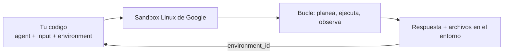
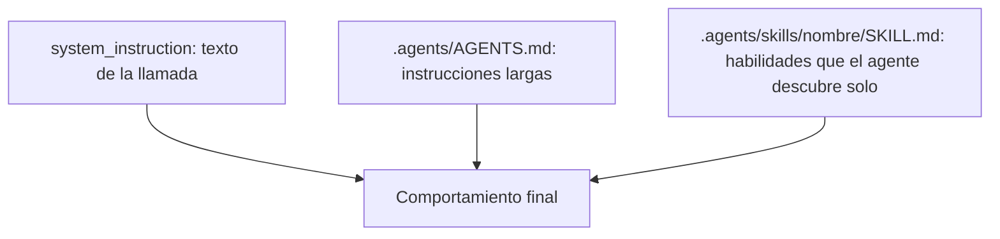
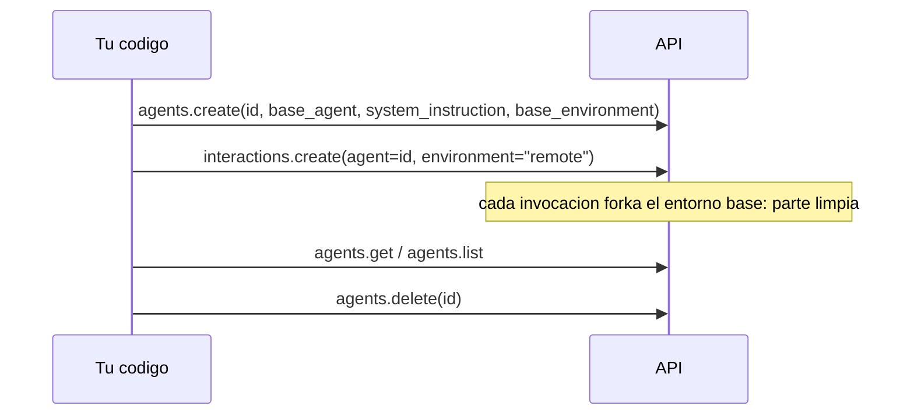

# Agentes gestionados (Antigravity): apunte

Resumen de la seccion 10 de la guia ("Run a managed agent"), con lo que se **comprobo ejecutando** (fecha 2026-11-14,
SDK `google-genai` 3.2.0, nivel gratuito). Lo que no se pudo comprobar esta marcado como **no verificado**.
Los problemas y trampas con su evidencia estan en [`../BITACORA.md`](../BITACORA.md).

## Que es

Un agente gestionado **no es un modelo**: es un agente (`antigravity-preview-09-2026`) que corre en una maquina Linux
(sandbox) de Google. Le das una tarea y el decide: razona, escribe y ejecuta codigo, lee y escribe archivos, busca en la
web... en un bucle autonomo. Tu llamada cambia `model=` por `agent=` y anade `environment="remote"`.

**No hay que instalar nada** para usarlos por API (todo corre en la nube). Opcionales que menciona la guia: el
Playground de AI Studio (web), el repositorio de plantillas
`google-gemini/gemini-managed-agents-templates` y un "Gemini API CLI" de codigo abierto. Ninguno se uso aqui.

## Mapa de subtemas (scripts de esta carpeta)

| # | Subtema | Script | Estado |
| :--- | :--- | :--- | :--- |
| 10.1 | Primera llamada | `primer_agente.py` | verificado |
| 10.2 | Multi-turno (conversacion + entorno) | `multi_turno.py` | verificado |
| 10.3 | Streaming | `streaming_agente.py` | verificado |
| 10.4 | Descargar el entorno | `descargar_entorno.py` | verificado (el .tar pesa ~95 MB) |
| 10.5 | Herramientas del agente | `herramientas_agente.py` | verificado |
| 10.6 | Entrada multimodal | `entrada_multimodal.py` | imagen y CSV verificados; PDF/audio/video no |
| 10.7 | Tus funciones en el agente | `funcion_propia_agente.py` | verificado (hay que repetir `tools`) |
| 10.8 | Servidores MCP | `mcp_agente.py` | verificado |
| 10.9 | Modelo y presupuesto | `modelo_y_presupuesto.py` | verificado |
| 10.10 | Segundo plano y cancelar | `segundo_plano.py` | verificado |
| 10.11 | Limites | `limites_agente.py` | parcial |
| 10.12-13 | Personalizar en linea (AGENTS.md, SKILL.md) | `personalizar_enlinea.py` | verificado |
| 10.14, 10.17, 10.19 | Agente guardado: crear, invocar, gestionar | `agente_guardado.py` | verificado |
| 10.15 | Fork de un entorno | `fork_y_red.py` | verificado |
| 10.16, 10.18 | Reglas de red y sobrescribirlas | `fork_y_red.py`, `red_control.py` | verificado (con una sorpresa) |
| 10.20 | Flujo de iteracion y limites | (solo lectura) | ver abajo |
| 10.21 | Triggers | `triggers.py` | verificado con borrado |
| 10.22-24 | Playground y seguridad | (solo lectura, es una interfaz web) | ver abajo |

## Las cuatro ideas que mas importan

### 1. Dos memorias independientes
`previous_interaction_id` = la **conversacion**; `environment=<environment_id>` = los **archivos** del sandbox.
Se combinan a gusto: con las dos el agente recuerda y ve sus archivos; solo con el entorno ve los archivos pero
"no recuerda ninguna tarea" (verificado).

### 2. Tres capas de personalizacion (aditivas)

Verificado: `system_instruction` (respuesta en espanol) + `AGENTS.md` (firma `-- Agent: ALFA --`) se aplicaron **a la
vez**; el agente abrio `SKILL.md` por su cuenta (`view_file`) y siguio sus instrucciones (`write_to_file`).
Con un agente guardado, **sobrescribir `system_instruction` al invocar no quita el `AGENTS.md`** del entorno base.

### 3. Ciclo de vida de un agente guardado

El `id` no puede empezar por `gemini-`, `google-`, `antigravity-`... (verificado: `400`, sin distinguir mayusculas). Los
agentes guardados son **recursos persistentes** del proyecto (hasta 1000): borrarlos al terminar.

### 4. El costo es el riesgo principal
- Una tarea trivial ("responde OK") gasta **~5 000 tokens** de base; Fibonacci con el modelo por defecto, ~25 000.
- `agent_config.max_total_tokens` es un freno **best-effort**: con tope 2 000 se gastaron 5 160 y el estado fue
  `incomplete`. Continuar costo casi lo mismo que una ejecucion nueva.
- Tu limite gratuito de Antigravity es 100K tokens/minuto, 100 peticiones/dia: espaciar las ejecuciones.
- Los modelos "lite" (`gemini-3.5-flash-lite`) cuestan menos y tienen mas cuota gratuita.

## Red y seguridad (lo mas delicado)

| Situacion | Resultado medido (`curl`, codigo HTTP) |
| :--- | :--- |
| Red por defecto | `pypi.org` 200, `example.com` 200: **abierta** |
| `allowlist` solo `pypi.org` | `pypi.org` 200, `example.com` **403** |
| Agente base con `allowlist` solo `example.com` | `pypi.org` **403**, `example.com` 200 |
| Agente guardado (solo `pypi.org`) + sobrescribir con solo `example.com` | **200 y 200**: parece **sumar**, no reemplazar (la doc dice "reemplaza") |

- Restringir `tools` **no corta internet**: un agente con solo `code_execution` llego igual a una pagina web.
  La red se controla con la `allowlist` del entorno.
- Las credenciales (`transform` con cabeceras, o `credential` guardada) las inyecta un proxy de salida; la guia
  recomienda permisos minimos, tokens de corta vida y rotarlos. **Aqui no se uso ninguna credencial real.**
- Dentro del sandbox el agente puede llamar a la API de Gemini con tu clave (coste extra que no sale en los tokens).

## Triggers (ejecuciones programadas)

`client.triggers.create(schedule="<cron>", time_zone=..., display_name=..., interaction={...})`. Se dispara solo y
gasta tokens sin supervision; todas las ejecuciones **reutilizan el mismo entorno**. Verificado con un horario lejano
(`0 3 1 1 *`), pausado al crear, **una** ejecucion manual con `triggers.run` (funciona estando pausado: `completed` en
~4 s, 4 943 tokens) y borrado. Metodos: `create`, `get`, `list`, `update(status=paused|active)`, `run`,
`list_executions`, `delete`.

## Playground de AI Studio (10.22 a 10.24, no se hizo por codigo)

Es una interfaz web (Playground -> interruptor **Agents**) para prototipar sin escribir llamadas:
- **Plantillas** de codigo abierto que preconfiguran el agente (herramientas, `AGENTS.md`, skills): se ven en Environment -> Sources.
- **Herramientas** activables: Google Search, URL Context, Code Execution, Filesystem.
- **Entorno**: fuentes inline (hasta 100 KB), bucket de Cloud Storage o repositorio de GitHub (los privados piden token); o
  reutilizar un `environment_id` existente.
- Una vez enviado el primer mensaje, el entorno queda **fijo**: no se pueden montar fuentes ni cambiar la allowlist.
- Botones **Download** (el entorno como tarball) y **Stop** (frenar un agente que se desvia).
- Seguridad y costo: poner **criterios de parada claros** en el prompt, acotar la tarea, vigilar al agente y
  **mantener supervision humana** en tareas que modifican datos o hablan con sistemas externos; en el Playground la red
  de salida esta restringida por defecto y se abre con una lista de dominios (por API esta abierta por defecto).

## Limites de la guia (10.11 y 10.20)

- Solo existe `antigravity-preview-09-2026` como agente base; preview: los esquemas pueden cambiar.
- Modelos de `agent_config`: `gemini-4-hydrogen` (defecto), `gemini-4-carbon`, `gemini-4-argon`, `gemini-3.8-flash`,
  `gemini-3.6-flash`, `gemini-3.5-flash-lite`. En agentes guardados el modelo **no se cambia al invocar**.
- Sin versionado ni vuelta atras de agentes; sin subagentes anidados.
- Flujo de iteracion recomendado: prototipar en linea -> estabilizar el entorno -> guardar (desde fuentes o por fork) -> actualizar.
- **Medido:** el SDK 3.2.0 impide `generation_config` junto a `agent=`; `file_search` y `computer_use` dan `400`;
  salida estructurada y un nombre MCP con mayuscula fueron **aceptados** aunque la guia dice que no.

## Que no se verifico

- Actualizar un agente guardado (la guia habla de "Update" en el flujo, pero no muestra un metodo).
- Fuentes `repository` (GitHub) y `gcs`, y credenciales guardadas (`agent-credentials`): no se usaron.
- Hooks dentro del sandbox, `allowed_tools` de MCP, y PDF/audio/video como entrada.
- `google_maps` con el agente (cuota 0/0); el estado `failed` en segundo plano.
