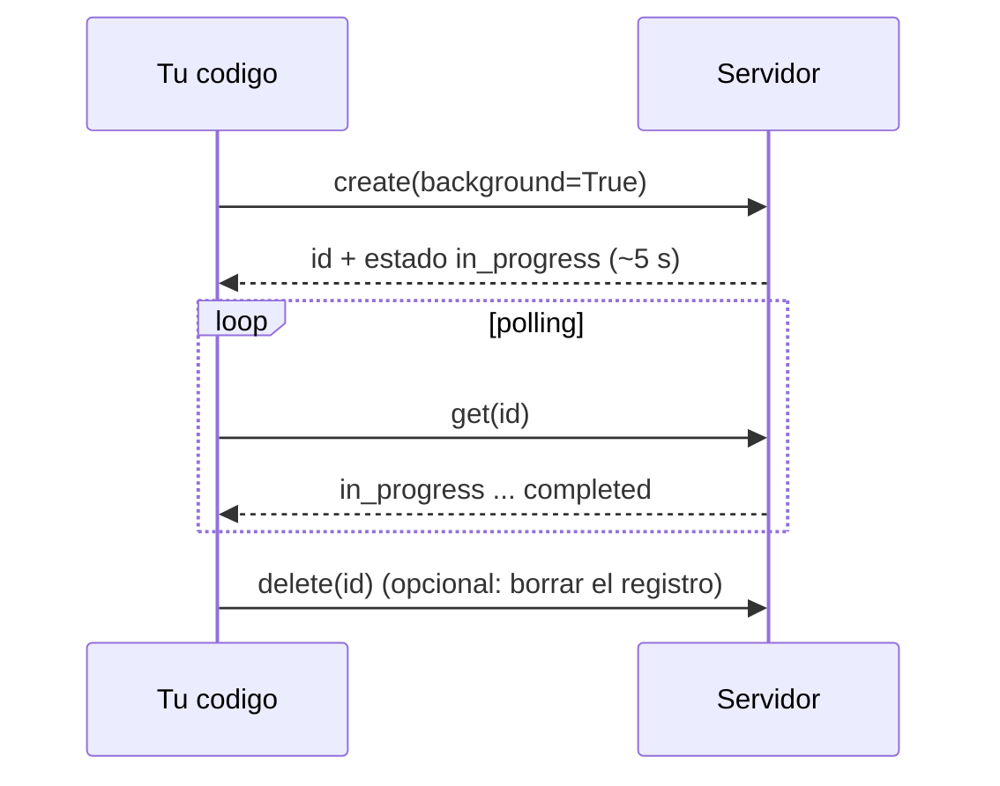
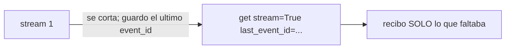

# Tareas en segundo plano (modelos normales): apunte

Resumen de la seccion 11 de la guia `get-started` ("Run tasks in the background"). Medido el 2026-11-14 con
`gemini-3.5-flash-lite` (nivel gratuito). En `09-agentes-gestionados/segundo_plano.py` ya vimos lo mismo con un agente.

## Idea

Una peticion HTTP normal se corta a los ~60 s. Con `background=True` la API **devuelve enseguida un id** y la tarea sigue
en el servidor; tu codigo pregunta por el resultado (*polling*) o lo sigue en vivo (*streaming*).

## Estados (segun la guia)

| Estado | Significado | Visto aqui |
| :--- | :--- | :--- |
| `in_progress` | el servidor esta trabajando | si |
| `requires_action` | pausado esperando algo tuyo (p. ej. resultado de una funcion) | si, con agentes (09.7) |
| `completed` | termino bien | si |
| `failed` | error (herramienta, cuota...) | no |
| `cancelled` | lo detuviste tu | si |

## Subtemas y resultados

| # | Subtema | Script | Resultado medido |
| :--- | :--- | :--- | :--- |
| 11.1-2 | Crear + polling + estados | `basico.py` (A) | vuelve en **5,1 s** con `in_progress`; ensayo de 426 palabras listo en **8 s** |
| 11.4 | Encadenar con `previous_interaction_id` | `basico.py` (C) | a una **en curso**: `400 "Previous interaction is not yet complete."`; tras completarse: funciona |
| 11.6 | `store` y retencion | `basico.py` (B) | `background=True` con `store=False`: `400 "store=true is required for background interactions."` |
| 11.3 | Streaming con reconexion | `streaming_reconexion.py` | cortando tras 2 trozos y reconectando con `last_event_id`: parte1 (4 591 car) + parte2 (321 car) = texto final (4 912 car), **sin huecos ni repetidos** |
| 11.5 | Cancelar y borrar | `cancelar_y_borrar.py` | `cancel` -> `cancelled` (salida parcial: 0 caracteres); tras `delete`, `get` -> **404 NotFound**; `cancel` sobre una ya completada -> sigue `completed`, sin error |

### Streaming con reconexion

Cada evento trae un `event_id`. Si se cae la conexion: `client.interactions.get(id=..., stream=True, last_event_id=<ultimo>)`.

**Ojo con la prueba:** el texto llego en pocos trozos **grandes** (~1 500 caracteres cada uno). Mi primer intento (cortar
tras 5 trozos) nunca llego a cortar porque el stream acabo antes; hubo que cortar tras 2. Para probar una reconexion de
verdad, el punto de corte tiene que ocurrir antes de que termine el flujo.

## Retencion de datos

- Segundo plano exige `store=True` (el valor por defecto): el servidor guarda la interaccion mientras haces polling.
- Plan gratuito: se conserva **1 dia**; plan de pago: 55 dias (configurable a 7, 14, 28 o 55 en AI Studio).
- Para borrarla antes: `client.interactions.delete(id=...)` (los scripts de esta carpeta lo hacen al final).

## Solo lectura (no se pudo probar)

- **Long decode (Gemini 4):** respuestas de mas de 65 536 tokens; `max_output_tokens` hasta 1 048 576 en `gemini-4-carbon`,
  `gemini-4-argon` y `gemini-4-hydrogen` (esos modelos no estan en tu lista). Sin segundo plano, una llamada normal tiene
  tope de 65 536 tokens de salida (32 768 sin streaming en carbon y argon).
- **Casos de uso:** agentes, *deep research* (`deep-research-preview-04-2026`, varios minutos), razonamiento largo.
- Modelos con segundo plano segun la guia: `gemini-4-*`, `gemini-3.8-flash` y los agentes gestionados. Aqui funciono
  tambien con `gemini-3.5-flash-lite`.

## Que no se verifico

- El estado `failed` (y el atributo `error` de la guia) y `requires_action` con modelos normales.
- Cancelar una interaccion en curso con salida parcial: la salida quedo vacia (0 caracteres), no probe con otros tiempos.
- Borrar un id inexistente dio `400` con un id mal formado (`v1_noexiste`); con un id bien formado podria ser `404`.
